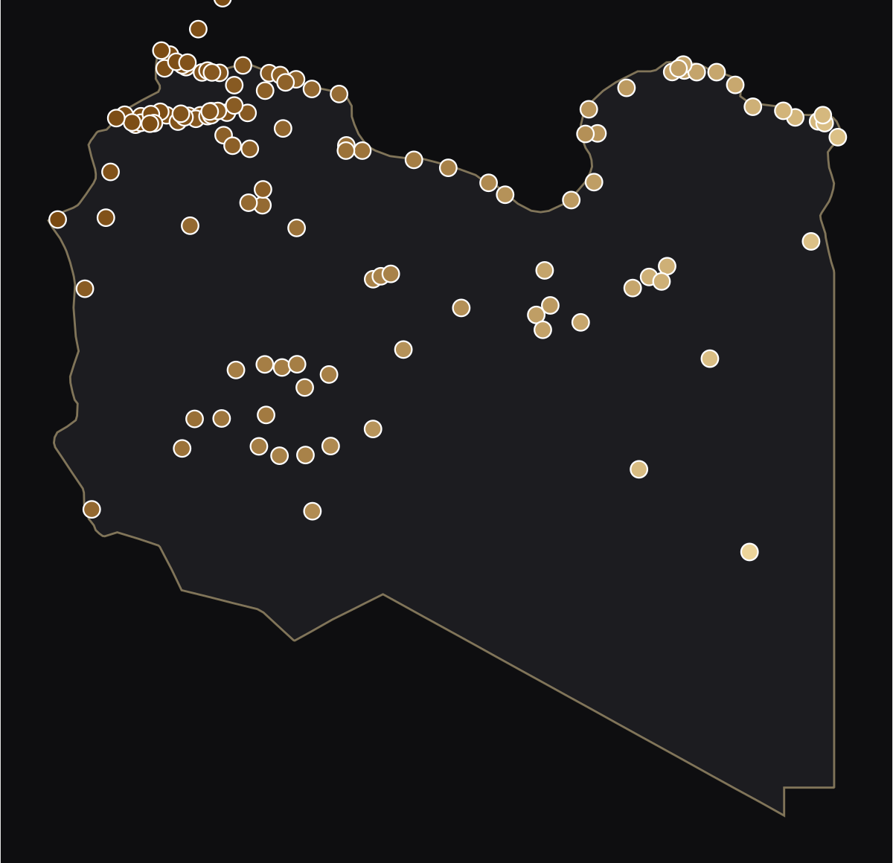
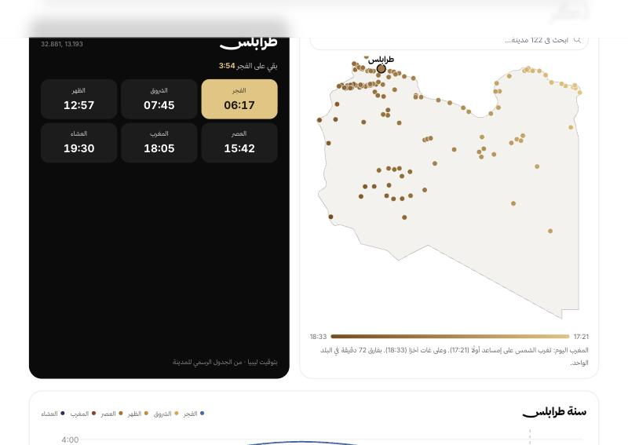
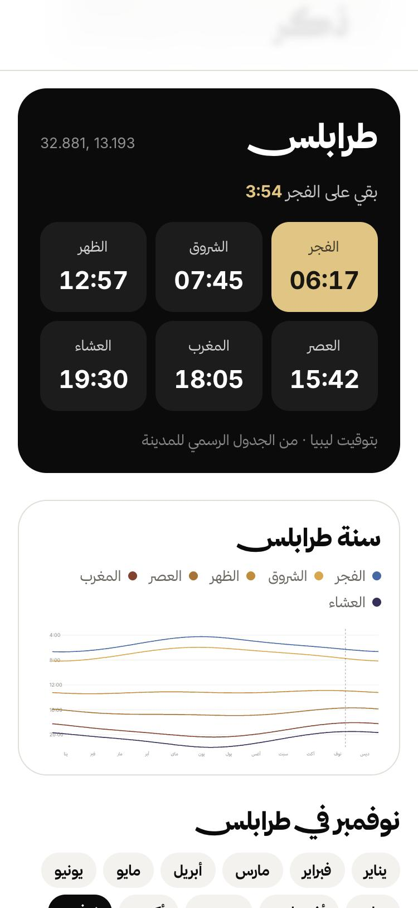

# مواقيت الصلاة في المدن الليبية · Libya prayer times

<p align="center"></p>

**الجداول الرسمية لمواقيت الصلاة في ١٢٢ مدينة ليبية**، كما تصدرها الهيئة العامة للأوقاف والشؤون الإسلامية: السنة كاملة، ٣٦٦ يومًا لكل مدينة (بالتاسع والعشرين من فبراير)، ستة أوقات في اليوم، بتوقيت ليبيا (`Africa/Tripoli`). مجانية، دون تسجيل، تُستعمل في أي مكان مع ذكر المصدر.

**The official prayer timetables of 122 Libyan cities**, as published by Libya's General Authority of Awqaf and Islamic Affairs: the whole year, 366 days per city (29 February included), six times a day, in Libya time (`Africa/Tripoli`). Free, no sign-up, use it anywhere with attribution.

### 🔗 [dhikr.ly/prayer-times](https://dhikr.ly/prayer-times): the interactive tool · الأداة التفاعلية

<p align="center">
  
  
</p>

## الملفات · Files

| | |
|---|---|
| [`data/libya-prayer-times.csv`](data/libya-prayer-times.csv) | صف لكل مدينة ويوم · one row per city and day (UTF-8 with BOM, opens in Excel) |
| [`data/libya-prayer-times.json`](data/libya-prayer-times.json) | المدن وأيامها · cities, each with its 366 days |
| [`data/libya-prayer-times.sqlite`](data/libya-prayer-times.sqlite) | جدولان · two tables: `cities`, `prayer_times (city, month, day, …)` |
| [`data/cities.json`](data/cities.json) | المدن · slug, Arabic and English name, coordinates, `new_fajr` |

Columns: `fajr, sunrise, dhuhr, asr, maghrib, isha` as `HH:MM` (24 h). `new_fajr: true` marks the eastern and southern cities whose Fajr the Awqaf moved to the true dawn (about 15° below the horizon).

```sql
-- Tripoli, today
SELECT * FROM prayer_times WHERE city = 'tripoli' AND month = 11 AND day = 24;
```

## واجهة برمجية دون مفتاح · Open API, no key

```
GET https://dhikr.ly/api/v1/prayer-times/libya                  # the cities
GET https://dhikr.ly/api/v1/prayer-times/libya/today            # today, every city
GET https://dhikr.ly/api/v1/prayer-times/libya/tripoli          # today in Tripoli
GET https://dhikr.ly/api/v1/prayer-times/libya/tripoli?date=2026-03-20
GET https://dhikr.ly/api/v1/prayer-times/libya/benghazi?month=9
GET https://dhikr.ly/api/v1/prayer-times/libya/sabha?year       # all 366 days
```

The tables change at most once a year: cache what you fetch. Outside Libya, [dhikr.ly/prayer-methods](https://dhikr.ly/prayer-methods) gives every country's calculation method, with `/api/v1/prayer-times/methods`, `/world/{country}` and `/calc?lat=&lng=&tz=`.

## المصدر · Source

- **الهيئة العامة للأوقاف والشؤون الإسلامية**، الجداول الرسمية لكل مدينة · Libya's General Authority of Awqaf and Islamic Affairs, the official timetable of each city.
- Compiled by the «مؤذن ليبيا» app and [Tawkit.net](https://www.tawkit.net); single-day typos repaired against their neighbours, as used in the Dhikr apps (أذان وأذكار، مصحف الجماهيرية، مصاحف ليبيا).
- Map: Natural Earth (public domain).

## الترخيص · License

[CC BY 4.0](LICENSE): use, share and build on it, commercially or not. Credit **«الهيئة العامة للأوقاف والشؤون الإسلامية»** and **«ذكر · [dhikr.ly](https://dhikr.ly)»**.

Errors or a missing city? Open an issue, or write from [dhikr.ly](https://dhikr.ly/prayer-times).
